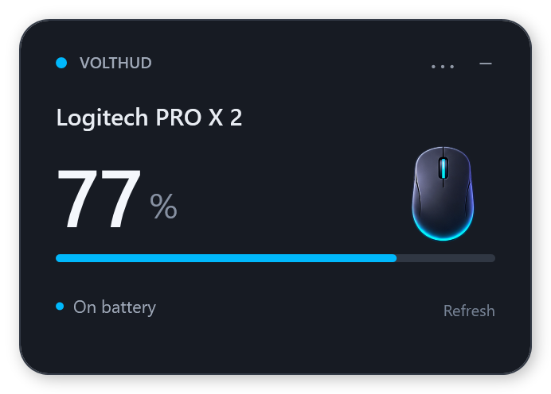
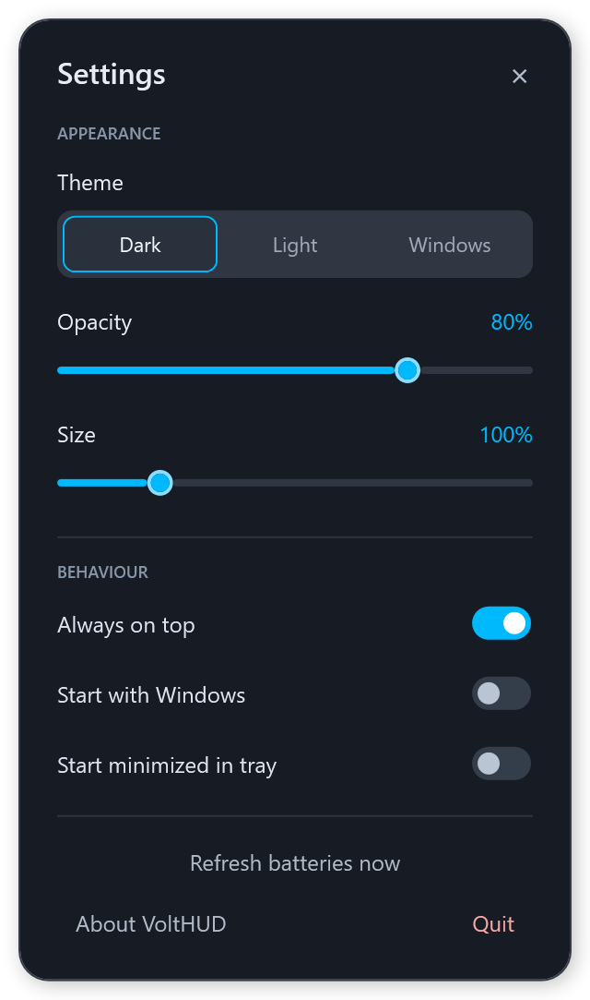
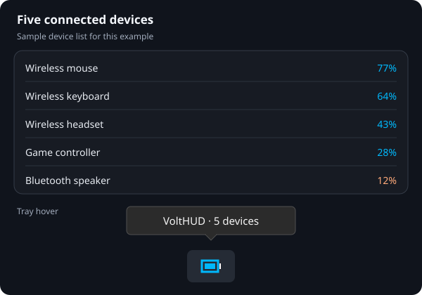

# VoltHUD


A small, quiet Windows desktop widget for connected device battery levels.

**0.1.1 preview** — portable battery monitoring for Windows.



## Code signing policy

See the [Code signing policy](CODE_SIGNING_POLICY.md). SignPath Foundation onboarding is being prepared; the current release remains unsigned. Planned signing is subject to approval and manual release authorization. [Integration setup](https://github.com/noriblis/VoltHUD/blob/main/signpath/SETUP.md).

## Download

Download **VoltHUD-windows.zip** from the [0.1.1 preview release](https://github.com/noriblis/VoltHUD/releases/tag/v0.1.1-preview). Extract the entire ZIP to a permanent folder and open **VoltHUD.exe**. No installer, administrator access, account, or companion software is required. Windows 10/11 with the built-in .NET Framework 4.8 is required. Windows on ARM has not been tested.

**This is an unsigned preview.** A clean antivirus scan cannot guarantee that antivirus or Windows SmartScreen will never show a warning. See [SECURITY.md](SECURITY.md). A signed release requires a trusted publisher certificate; this project does not install a certificate or change Windows protections.

## Use

- Drag the header to move the widget. Its position is saved.
- All connected peripherals appear together in the widget, each with its own icon, battery level and status. The widget grows with the list and scales to fit the screen.
- **⋯ → Theme** chooses Dark, Light or Windows. Windows follows your current Windows app theme and selected Windows accent colour automatically.
- **⋯ → Always on top** keeps the widget above other windows.
- **⋯ → Opacity** adjusts transparency from 20% to 100%, previews it immediately, and saves it for next time.
- **⋯ → Size** scales the entire widget from 75% to 200% and saves the selected size.
- **⋯ → Start with Windows** enables startup for your Windows account. Off by default. If you move the app, toggle this option again to update its location.
- **⋯ → Start minimized in tray** hides the widget on launch while battery monitoring continues. Off by default. Double-click the tray icon or launch VoltHUD again to show it.
- **−** hides the widget in the notification area. Double-click its battery icon, or launch VoltHUD again, to show it.
- **Refresh** or **F5** checks again. Automatic refresh runs every 5 minutes.
- **⋯ → Quit** exits, including the tray icon.

Blue accents use `#00B8FC`. A low numeric battery level uses an orange accent. Unknown battery levels display a dash. Coarse levels such as “Good” remain words; voltage-derived levels are explicitly labelled as estimates.

### Settings preview



Open **⋯** to adjust the widget's appearance, startup behaviour and low battery notifications. The preview shows sample settings in the Dark theme.

### Tray hover preview



Hover over the blue battery tray icon for a quick status. With one device, the tooltip shows its name and battery percentage; with multiple devices, it shows the device count. This is an illustrative preview—Windows controls the tooltip's appearance. Double-click the icon to show the widget, or right-click it to open settings.

## Compatibility

VoltHUD discovers battery capabilities instead of maintaining a hardcoded list of supported model names. It supports connected Bluetooth devices from any brand and peripherals using the battery interfaces listed below. Compatibility depends on each device and Windows; some devices use proprietary formats that are not implemented or expose no usable battery information.

| Interface | Implemented reading | Verification |
| --- | --- | --- |
| Logitech HID++ 2.0 | Unified battery `0x1004`, status `0x1000` | PRO X 2 mouse verified over its receiver |
| Logitech HID++ voltage | `0x1001`, headset ADC `0x1F20` | Decoder tests; additional hardware testing needed |
| Logitech HID++ 1.0 | Read-only battery registers `0x0D` and `0x07` | Decoder tests; additional hardware testing needed |
| Logitech Centurion | Discovered direct/bridged battery feature `0x0104` | Decoder tests; transport needs hardware testing |
| Bluetooth, all brands | Windows battery property matched to connected classic/LE endpoints | Enumeration tested; battery hardware testing still needed |
| Bluetooth LE | Standard Battery Service `0x180F`, Battery Level `0x2A19` | Implemented; battery hardware testing still needed |

Receiver slots 1–6 and the direct USB device index are queried. HID++ vendor collections and known headset collection formats are used. Keyboards, trackballs and headsets are not filtered out. Device IDs distinguish identical models when the hardware provides a unit ID. Firmware without the documented battery features, unsupported proprietary headsets, and Bluetooth devices that do not expose battery information may have no reading.

Bluetooth entries are filtered by Windows' connected state, not merely by paired status. Windows-supplied battery values can be cached. Bluetooth normally does not provide a charging flag, so VoltHUD does not infer one. No Bluetooth pairing or radio settings are changed.

## Privacy

The app has no internet client, analytics, advertising, automatic updater, or automatic startup registration. It reads local HID/Windows/Bluetooth battery interfaces. It saves position, opacity, size, start-minimized, always-on-top, theme and notification preferences in `%LOCALAPPDATA%\VoltHUD\settings.txt`. Device identifiers are used locally for matching and never uploaded. Hashed warning history is stored in `low-battery-alerts.txt` in the same folder.

Optional local diagnostic: `VoltHUD.exe --diagnose diagnostic.txt`. This includes device names and battery information, but no serial numbers, device paths, or Bluetooth addresses. Review it before sharing. `--windowed` shows a taskbar entry. `--preview path.png` renders an illustrative preview using sample data.

## Build and test

On Windows 10/11, from the repository directory:

```powershell
.\build.ps1
.\test.ps1
.\ui-test.ps1
.\package.ps1
```

The scripts use the Windows inbox C# compiler, .NET Framework assemblies, and Windows Runtime metadata. No third-party packages or SDK download is needed. The app is written in C# using WPF, a tray icon, and Windows' HID and Bluetooth APIs. Output: `dist\VoltHUD.exe`. Tests validate malformed battery data, feature formats, charging states, coarse-level handling and voltage interpolation bounds. They cannot replace hardware compatibility testing.

Routine UI checks keep simulated widgets hidden. The visible stress test requires `ui-test.ps1 -Interactive`; it repeatedly opens settings and should only run when desktop activity is acceptable. See [LOCAL_REVIEW.md](LOCAL_REVIEW.md) for completed stress-test results and hardware limitations.

`package.ps1` prepares the ZIP, executable and SHA-256 checksums in `release\0.1.1-preview`. It performs no uploads, pushes, tags or publication. Publication requires the project owner's explicit instruction. See [RELEASE_NOTES.md](RELEASE_NOTES.md) for current limitations.

## Protocol references

- [Logitech HID++ documentation](https://github.com/Logitech/cpg-docs/tree/master/hidpp20)
- [Solaar protocol documentation and research](https://github.com/pwr-Solaar/Solaar)
- [HeadsetControl headset protocol research](https://github.com/Sapd/HeadsetControl)
- [HaloBattery protocol descriptions](https://github.com/HeyOkay/HaloBattery/blob/main/docs/protocols.md)
- [Microsoft Bluetooth device enumeration](https://learn.microsoft.com/en-us/windows/apps/develop/devices-sensors/enumerate-devices)

Independent project. Device and manufacturer names identify connected hardware; they do not imply affiliation or endorsement.

Code and supplied artwork are distributed under the [MIT License](LICENSE). See [artwork provenance](assets/README.md).

Start with Windows is opt-in. Enabling it creates only the current user's VoltHUD Run entry; disabling it removes that entry. It requires no administrator access.

Local simulation: launch `VoltHUD.exe --demo` to explore eight clearly labelled sample devices. It performs no hardware queries or startup registration and does not save simulation preferences. The widget footer states that battery percentages update every five minutes.

Settings use a custom panel matching the selected theme. Open it with the widget's ⋯ button, by right-clicking the widget, or by right-clicking the tray icon. Unidentified device types use the supplied Bluetooth question-cube artwork.

Discovery recovery: device name/type requests are retried, confirmed identities are retained for the same hardware unit, and incomplete startup discovery is retried automatically. USB device changes trigger a fresh scan. Regular battery refresh remains five minutes.

Memory cleanup: individual icons are prepared during the build; settings are loaded on demand; unchanged readings reuse their display rows. See [MEMORY.md](MEMORY.md) for measured local results and limitations.

Low battery notifications can be enabled in Settings and work while the widget is hidden in the tray. VoltHUD requests one native Windows notification when a known device reports less than 10% battery, excluding charging devices. Checks run every five minutes or on manual refresh. Each device warns once until it recovers to at least 15%; refreshes, disconnects, preference changes and app restarts do not repeat the warning. Alert history is stored locally as hashed device identifiers, with a limit of 256 entries. Clicking the notification opens the widget. Windows notification settings and Do Not Disturb control delivery. This option is off by default, and simulations never send notifications.

To remove VoltHUD, disable **Start with Windows**, choose **Quit**, and delete its extracted folder. Optionally delete `%LOCALAPPDATA%\VoltHUD` to remove preferences and warning history. Removing warning history resets duplicate-warning suppression.
